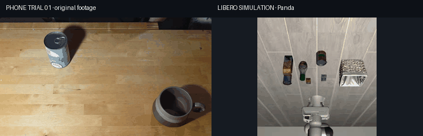
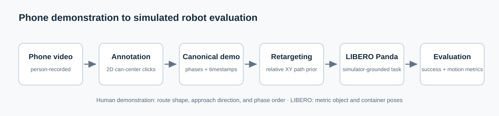
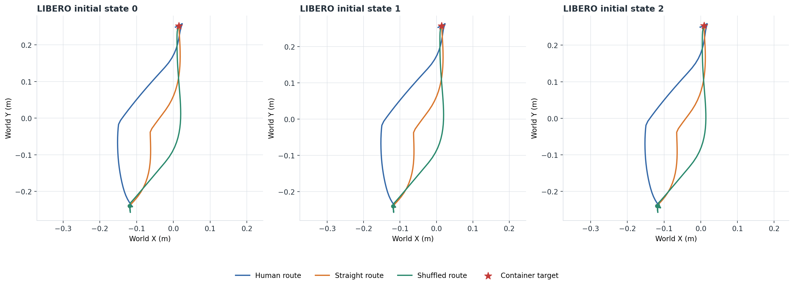
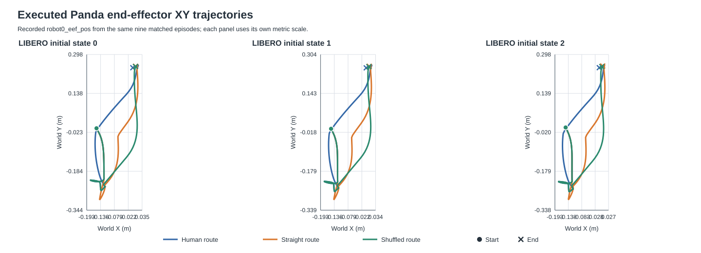
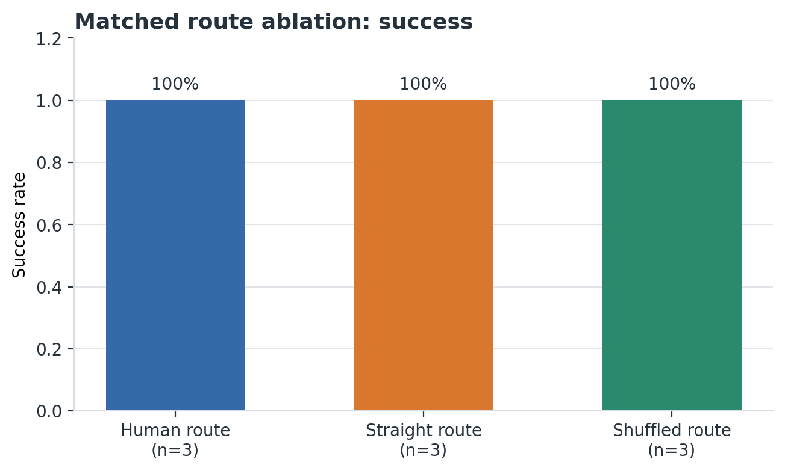
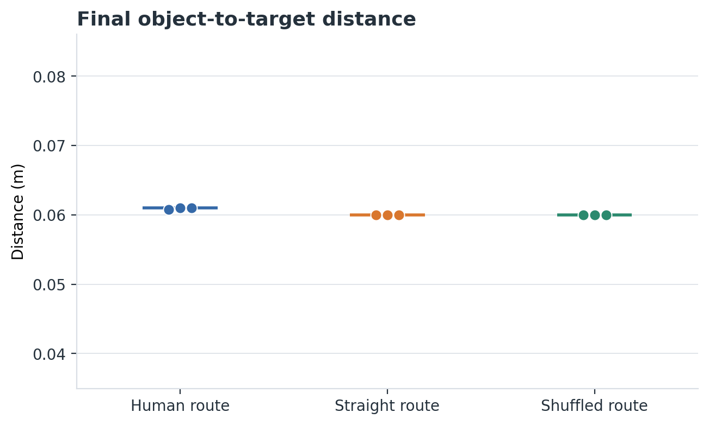
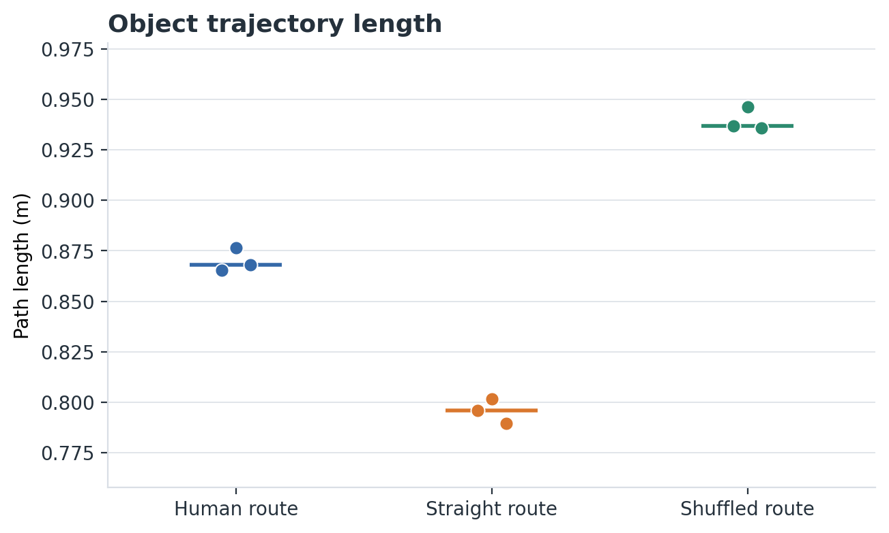
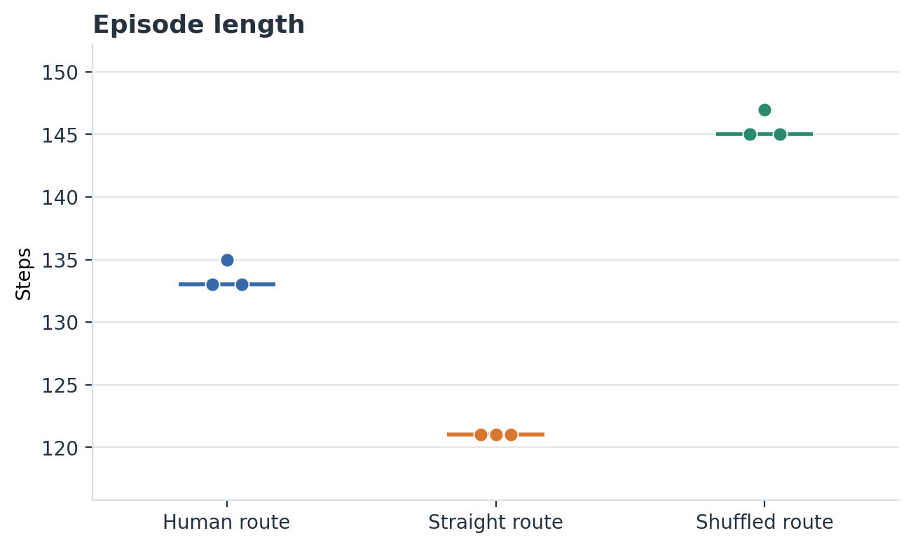

# Ego2Robot

**Can sparse points from a phone-recorded pick-and-place demonstration change a simulated Panda's route?** Ego2Robot tests this with a fixed, hand-coded controller in LIBERO. Human annotations provide a route prior; simulator state anchors metric placement.

<p align="center">
  
</p>

Phone trial 01 is shown beside the corresponding Panda run using the original, unblurred phone footage. The clips are not synchronized or geometrically calibrated.

## Pipeline



## Method

The person clicks the can's image center at five ordered phases: `start`, `approach`, `grasp`, `transport`, and `release`. These normalized 2D points describe object motion; they do not measure depth, hand pose, or force.

| Input | Controls | Does not control |
|---|---|---|
| Human phase keypoints | Relative XY path shape and start-to-grasp approach direction | Metric XYZ, grasp offset, gripper force, phase duration |
| LIBERO state | Live can and basket poses, Panda pose, task success | Demonstration route shape |
| Fixed controller | Hover/lift/release offsets, approach stand-off, reach tolerances, gripper open/close schedule, action scaling | Learned adaptation |
| Annotation timestamps/confidence | Stored in canonical JSON | Not used to schedule actions or change control |

`SimpleGeometricRetargeter` maps image-plane displacements between the live simulated can and basket endpoints. `DemoConditionedPolicy` follows phase waypoints, but uses live simulator poses for start, grasp, and release. The approach direction comes from the annotated start-to-grasp vector; transport XY uses the retargeted route point. Hand-coded offsets include 8 cm approach stand-off and 12 cm hover/carry lift. This is geometric retargeting with a motion prior, not policy training.

Geometric retargeting was selected over VLA fine-tuning because the labelled dataset is limited to six short demonstrations with five sparse points each, and the monocular videos have no camera calibration or depth. A VLA would add compute and training complexity without resolving that missing geometry. The mapping is computationally simple and interpretable: it keeps the annotated relative XY route while simulator poses provide metric anchors. No VLA was trained or fine-tuned.

## Experiment

We compare three route conditions with the same `DemoConditionedPolicy`, grasp/release behavior, task, and evaluator:

- **Human:** the five annotated points.
- **Straight:** preserve endpoints and project each interior (`approach`, `grasp`, `transport`) point onto the start-to-release line.
- **Shuffled:** preserve endpoints and phase order, but deterministically permute the three interior XY points (shuffle seed 23).

Each route is evaluated at the same LIBERO task 0 initial-state IDs `0`, `1`, and `2`, with seed 0, 10 settle steps, a 500-step limit, and 20 post-release steps. These are distinct saved simulator initializations; the can start pose is identical, while basket and Panda starting poses vary modestly. Treat this as a small matched comparison, not a broad robustness test.

| Route prior | Episodes | Success | Final distance m: median (range) | Object path m: median (range) | Steps: median (range) |
|---|---:|---:|---:|---:|---:|
| Human | 3 | 3/3 (100%) | 0.0610 (0.0608–0.0610) | 0.8681 (0.8652–0.8763) | 133 (133–135) |
| Straight | 3 | 3/3 (100%) | 0.0600 (0.0600–0.0600) | 0.7960 (0.7894–0.8015) | 121 (121–121) |
| Shuffled | 3 | 3/3 (100%) | 0.0600 (0.0600–0.0600) | 0.9366 (0.9357–0.9464) | 145 (145–147) |

**Observed:** all nine episodes succeeded, and the measured object paths differed. Final object-to-target distances were close across routes. Straight paths were shortest (median 0.796 m, 121 steps); shuffled paths were longest (0.937 m, 145 steps); the human path was between them (0.868 m, 133 steps). **Interpretation:** the annotations change robot movement, but did not improve task completion or final placement over the straight route in these three states. The fixed metric anchors and controller dominate the placement endpoint. This is evidence from one annotated demo and three modestly varied simulator initializations only.

The six personal annotations were each run once with the same demo-informed controller at LIBERO initial-state ID 0 (seed 0); all six completed. This is a separate fixed-state demonstration set, not the three-state route ablation below.

| Demonstration | Success | Final distance (m) | Object path (m) | Steps | Grasp contact |
|---|---:|---:|---:|---:|---:|
| phone_demo_001 | Yes | 0.061 | 0.865 | 133 | Yes |
| phone_demo_002 | Yes | 0.060 | 0.905 | 136 | Yes |
| phone_demo_003 | Yes | 0.060 | 0.964 | 141 | Yes |
| phone_demo_004 | Yes | 0.060 | 1.064 | 188 | Yes |
| phone_demo_005 | Yes | 0.061 | 0.857 | 124 | Yes |
| phone_demo_006 | Yes | 0.060 | 0.804 | 123 | Yes |

These are six single runs at the same initial state, not six independently sampled simulator conditions.



The following figure uses the per-step `robot0_eef_pos` values recorded during those same nine episodes. It compares the **executed Panda end-effector XY trajectories**, rather than the annotated or retargeted waypoints.



The episode-level metrics are in [`results/route_ablation.csv`](results/route_ablation.csv); per-step object and end-effector paths are in [`results/route_ablation_trajectories.csv`](results/route_ablation_trajectories.csv). The summary plots show success, final distance, object path length, and episode steps.

<table>
  <tr>
    <td></td>
    <td></td>
  </tr>
  <tr>
    <td></td>
    <td></td>
  </tr>
</table>

The older generic-controller baseline uses different control logic and is reported only as a historical reference, not as evidence that human routes improve performance. Its one fixed-state episode failed to place the can within 500 steps (final distance 0.513 m; path length 0.006 m; finger-pad contact was observed). The six fixed-state annotation runs above are also not a matched baseline comparison. See [`results/controller_comparison.md`](results/controller_comparison.md) and [`results/phone_demo_generalization.md`](results/phone_demo_generalization.md).

## Research Extensions

These optional studies are separate from the geometric MVP. The frozen `DemoConditionedPolicy` and successful MVP experiments are unchanged. Neither model is a successful learned manipulation policy.

**Offline sparse-keypoint ridge regression.** On this small, single-session dataset, trial-level leave-one-out evaluation across 18 annotated trials reduced mean intermediate keypoint error from **0.2034** normalized image units for straight interpolation to **0.0701** for ridge regression; ridge was lower-error on 18/18 held-out trials. This is a prediction result on sparse human labels, not continuous motion reconstruction, cross-session generalization, or a robot-performance gain. The script, fitted weights, per-trial and held-out predictions, annotations, and figure are included. It requires no source video.

**Human hand-side approach regression.** Trained from five positive approach examples, this separate ridge model's held-out mean angular error was **18.30°**, worse than the constant-direction baseline (**15.57°**). With the same frozen controller and matched saved simulator states, the learned approach achieved **0/3 grasps**, versus **3/3** for both the scripted straight and human-geometric routes. The learned route changed robot motion but did not produce a successful grasp or downstream improvement. See the [paired failure diagnostic](docs/learned_grasp_failure_diagnostic.md). The model, interaction annotations, logs, metrics, and trajectories are included; they use no private video. Replaying the simulator requires the pinned LIBERO environment in [`docs/setup.md`](docs/setup.md).

The supplementary interaction exports have 28 hand points across 70 events; absent/occluded points remain missing. Their source metadata has a known stale label, recorded in the [audit](results/interaction_dataset_audit.json). No recovery behavior or learned policy was implemented. See [research methods and reproduction commands](docs/research_extensions.md) for detail.

## What worked and what did not

- The frozen demo-informed controller completed the successful `phone_demo_001` sequence and all six previously recorded fixed-state demo runs.
- The current route experiment measures how changing the human path changes the object trajectory, while keeping grasp/release logic fixed.
- The earlier absolute video-to-world attempt was unreliable because the videos have no camera calibration or depth. Simulator ground truth remains necessary for metric anchors.
- The fixed-state generic baseline contacted the can but failed to place it.

## Reproduce

Follow [`docs/setup.md`](docs/setup.md) to install the pinned LIBERO environment. From the repository root:

```bash
python -m unittest discover -s tests -v
python scripts/validate_demo.py data/processed/phone-demo-001.json
python scripts/evaluate.py --policy demo --demo-json data/processed/phone-demo-001.json --seed 0 --initial-state-id 0 --max-steps 500 --settle-steps 10 --post-release-steps 20
python scripts/evaluate_route_ablation.py --seeds 0 --initial-states 0 1 2
python results/presentation/generate_plots.py
python results/presentation/generate_eef_trajectory_plot.py
```

To recreate the paired preview from local source footage, provide `--phone-video` to `results/presentation/generate_demo_gif.py`. The script reads the original phone clip without altering its frames and writes the paired preview to the requested output path. Raw phone clips are not included in the publication candidate. The browser annotator is [`tools/manual_video_annotator.html`](tools/manual_video_annotator.html).

## Scope and limits

The original geometric MVP is six demonstrations, one LIBERO task, and a hand-designed controller. The optional extension adds an offline keypoint predictor and a failed hand-approach experiment; it does not add a successful learned manipulation policy. Annotation timestamps and confidence scores are stored in the canonical JSON but are not used to schedule actions, weight waypoints, or otherwise change control. Recovery-event annotations are supplementary human data; they are not evidence of implemented or evaluated robotic recovery. No RL, VLA fine-tuning, physical Panda evaluation, calibrated video-to-world transform, or uncertainty estimate was implemented. The matched route ablations use a few saved simulator states and do not establish broad generalization.

Future work could quantify uncertainty in clicks and retargeted waypoints, detect stalled execution, and request a human correction before continuing. That is a proposed extension, not a result of this project.

## License and data

The software is MIT-licensed. The annotation JSON files are included for reproducibility; no separate license is specified for the personal recordings or labels. Full source videos are kept out of this publication candidate. The paired preview is an unblurred excerpt from phone trial 01.
