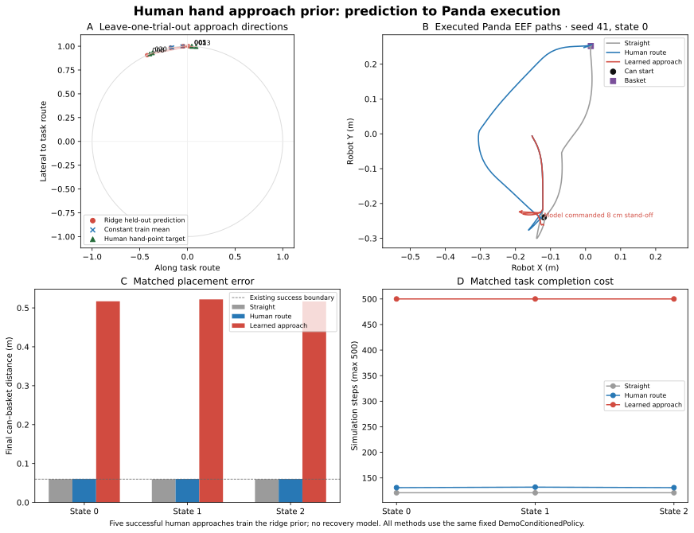

# Supplementary hand-approach experiment

This local research-branch experiment uses the separately exported manual hand/object interaction points. It does not replace the canonical can-centre annotation format or alter the frozen `DemoConditionedPolicy` controller.

## Data audit

Twelve interaction exports were matched to their canonical trial annotations and source videos. The exports contain 70 events, 28 manually supplied hand points, and 42 events without a hand point. All 70 timestamps and can-centre coordinates match their canonical events (to three decimal places); the 28 available hand points yield 28 hand-to-can vectors. Hand points were visually reviewed in overlays with can centres. Occlusion is represented as missing points and is not interpolated. This is a sparse point set, not continuous tracking.

The label export has stale `annotation_source` metadata on the supplied hand points. The source JSONs are preserved unchanged; the parser treats a non-null hand point as a supplied point and the audit flags that metadata issue. Trials 09–11 contain recovery event labels, but only one trial has a complete hand-point sequence through realignment. Trial 08 does not explicitly disambiguate lift/slip from repeated grasp labels. There is not enough trial-level supervision to train or evaluate recovery prediction.

## Approach-direction predictor

The predictor is deliberately small: ridge regression with five positive approach examples, grouped leave-one-trial-out. Trials containing an explicit `failed_contact/push` are excluded from positive grasp-approach supervision. The target is the unit hand-minus-can vector in a task-aligned image basis. At robot execution, this direction is mapped into the live simulator object-to-target basis and changes only the policy's approach-direction input. The bridge evaluates the model once at episode initialization using fixed task-relative features `(0, 0)`; it is not dynamically updated from perception as the episode proceeds. The existing controller, offsets, tolerances, grasp schedule, and metric object/target anchors are unchanged. Neither annotations' timestamps nor confidence scores control timing or prediction weighting.

| Predictor | Held-out mean angular error | Fixed 8 cm waypoint error |
|---|---:|---:|
| Constant training mean | 15.57° | 0.0217 m |
| Ridge model | 18.30° | 0.0254 m |
| Straight, from task start side | 83.16° | 0.1055 m |

The learned predictor does not outperform the constant mean on held-out approach direction. The straight geometric direction is a weak reference, not a learned baseline.

## Robot action check

The learned output is connected to the same fixed `DemoConditionedPolicy`; it changes the commanded approach direction while leaving controller mechanics untouched. A matched check on saved state 0 (seed 41) produced:

| Route | Success | Final can-target distance | Object path | EEF path | Steps |
|---|---:|---:|---:|---:|---:|
| Straight | Yes | 0.0600 m | 0.8013 m | 1.1925 m | 121 |
| Human | Yes | 0.0606 m | 0.9820 m | 1.3822 m | 131 |
| Learned approach | No | 0.5170 m | 0.0312 m | 0.4504 m | 500 |

Across three matched saved initial states (seed 41), straight and human routes each succeeded 3/3, while learned approach succeeded 0/3. Median final distances were 0.0600 m, 0.0606 m, and 0.5170 m, respectively; median object paths were 0.8013 m, 0.9820 m, and 0.0312 m; median EEF paths were 1.1930 m, 1.3900 m, and 0.4623 m; median steps were 121, 131, and 500. Each learned run had sustained single-finger contact, but did not establish a grasp or transport the can. This is direct evidence that the model changes robot behavior, and negative evidence for useful task performance in these conditions.



## Scope

This is an exploratory five-trial predictor evaluation and a small deterministic simulator comparison, not a generalization result. The interaction exports are from one phone recording session; leave-one-trial-out does not establish cross-session performance. No hand tracker generated these labels, no continuous motion was reconstructed, and no recovery policy, learned robot policy, VLA, or new controller was implemented.

Reproduce the data/model audit and fit with these commands from the repository root. Outputs go under `results/reproduction/` so they do not overwrite committed metrics or models:

```bash
python scripts/audit_interaction_dataset.py --interaction-dir data/interaction_annotations --canonical-dir data/processed --output results/reproduction/interaction_audit.json
python scripts/train_interaction_approach.py --interaction-dir data/interaction_annotations --canonical-dir data/processed --output-dir results/reproduction/interaction_learning
python scripts/evaluate_interaction_approach.py --demo-json data/processed/phone-demo-018.json --interaction-model results/reproduction/interaction_learning/approach_model.json --initial-state-ids 0 1 2 --seed 41 --output-dir results/reproduction/interaction_learning/matched
python scripts/plot_interaction_approach.py --results-dir results/reproduction/interaction_learning/matched --output results/reproduction/interaction_learning/approach_to_robot_action.svg
```

The plot combines the committed leave-one-trial-out prediction CSV with the newly reproduced matched-run traces. It requires Matplotlib from `requirements-libero-smoke.txt`; the audit and model-fit commands require only the package's NumPy dependency. Replaying the simulator comparison requires the pinned LIBERO environment in [setup](setup.md).
